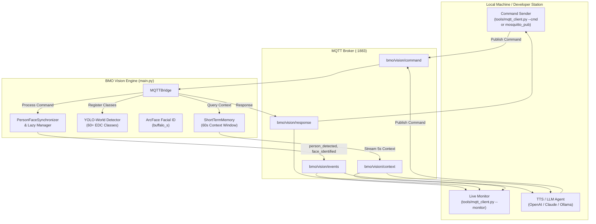

# BMO Assistant — MQTT Coordination & Command Verification Guide

This guide explains how to set up, monitor, and execute every MQTT command and event supported by the BMO Computer Vision system from your local machine.

---

## 1. Architecture Overview

BMO Computer Vision features a bidirectional, non-blocking MQTT JSON bridge running at sub-millisecond network dispatch (`TCP_NODELAY` + `orjson`).



---

## 2. Setting Up an MQTT Broker

Before running BMO with MQTT enabled, an MQTT broker must be running on port `1883`. Choose any one of the options below:

### Option A: Standalone Python Broker (Recommended — Zero Install)
A lightweight asyncio broker is provided directly in `tools/simple_broker.py` with zero dependencies:
```bash
/home/judas/bmo-assistant/.venv/bin/python tools/simple_broker.py
```

### Option B: Native Mosquitto
```bash
sudo pacman -S mosquitto
mosquitto -v
# Or start as a systemd service:
# sudo systemctl start mosquitto
```

### Option C: Docker Container
```bash
docker run -it --rm -p 1883:1883 eclipse-mosquitto
```

### Option D: Connect to an Existing Network Broker (e.g. Raspberry Pi / Home Assistant)
Set the environment variables before starting the pipeline:
```bash
export BMO_MQTT_HOST=192.168.1.50
export BMO_MQTT_PORT=1883
```

---

## 3. Starting the BMO Vision Pipeline

Once your broker is running, launch BMO Vision:

```bash
# Interactive GUI mode with OpenCV display window:
/home/judas/bmo-assistant/.venv/bin/python assistant_cv/main.py

# Or Headless mode (no GUI window, for server/background deployment):
/home/judas/bmo-assistant/.venv/bin/python assistant_cv/main.py --headless
```

When connected, the pipeline prints:
```
[MQTTBridge] Connected to localhost:1883, subscribed to 'bmo/vision/command'
```

---

## 4. Monitoring MQTT Traffic from Your Local Machine

Open a dedicated terminal to monitor real-time vision events, command responses, and short-term memory context.

### Method 1: Using the BMO CLI Monitor (Colorized & Structured)
```bash
/home/judas/bmo-assistant/.venv/bin/python tools/mqtt_client.py --monitor
```
**Sample Live Output:**
```
[13:30:01] [EVENT] PERSON_DETECTED: {"count": 1, "diff": 1}
[13:30:02] [EVENT] FACE_IDENTIFIED: {"name": "User"}
[13:30:05] [CONTEXT] Seeing User (center, close). Visible objects: 1 laptop, 1 lighter.
[13:30:10] [RESPONSE] get_context -> SUCCESS (req: req-get_context-421)
```

### Method 2: Using Standard `mosquitto_sub`
```bash
mosquitto_sub -h localhost -p 1883 -t "bmo/vision/#" -v
```

### Method 3: Using MQTTX (Desktop GUI)
1. Download [MQTTX](https://mqttx.app/).
2. Create a new connection to `Host: localhost`, `Port: 1883`.
3. Add a subscription to topic `bmo/vision/#`.

---

## 5. Executing Commands Step-by-Step

All commands are published to topic `bmo/vision/command` and acknowledge on `bmo/vision/response`.

### 5.1 System & Orchestration Commands

#### 1. `status`
Queries current pipeline health, frame rate, lazy mode state, and toggle statuses.
- **Python CLI**:
  ```bash
  python tools/mqtt_client.py --cmd status
  ```
- **mosquitto_pub**:
  ```bash
  mosquitto_pub -h localhost -t "bmo/vision/command" -m '{"command": "status", "request_id": "req-01"}'
  ```
- **Expected Response (`bmo/vision/response`)**:
  ```json
  {
    "type": "command_response",
    "command": "status",
    "status": "ok",
    "request_id": "req-01",
    "data": {
      "fps": 43.2,
      "lazy_mode": true,
      "toggles": { "1:OBJ": true, "2:FACE": true, "3:SIGN": true, "L:LAZY": true, "T:TRK": true },
      "persons_in_view": 1
    }
  }
  ```

---

#### 2. `get_context`
Queries an immediate snapshot of short-term visual memory and natural-language scene summary for LLM prompt injection.
- **Python CLI**:
  ```bash
  python tools/mqtt_client.py --cmd get_context
  ```
- **mosquitto_pub**:
  ```bash
  mosquitto_pub -h localhost -t "bmo/vision/command" -m '{"command": "get_context", "request_id": "req-02"}'
  ```
- **Expected Response (`bmo/vision/response`)**:
  ```json
  {
    "type": "command_response",
    "command": "get_context",
    "status": "success",
    "request_id": "req-02",
    "data": {
      "context": {
        "timestamp": 1794053000.0,
        "summary": "Seeing User (center, close). Visible objects: 1 laptop, 1 lighter.",
        "current_persons": [
          { "track_id": 1, "identity": "User", "face_conf": 0.88, "position": "center", "proximity": "close" }
        ],
        "current_objects": [
          { "label": "laptop", "count": 1 },
          { "label": "lighter", "count": 1 }
        ],
        "recent_persons": [],
        "recent_signs": [],
        "known_persons": ["User"],
        "registered_objects": ["lighter"]
      }
    }
  }
  ```

---

#### 3. `set_mode`
Switches pipeline execution state between `lazy` (models sleep when no person is present), `active` (all models run continuously), or `idle` (face and sign workers forced to sleep).
- **Python CLI**:
  ```bash
  python tools/mqtt_client.py --cmd set_mode --mode lazy
  ```
- **mosquitto_pub**:
  ```bash
  mosquitto_pub -h localhost -t "bmo/vision/command" -m '{"command": "set_mode", "mode": "active"}'
  ```
- **Expected Response**:
  ```json
  { "type": "command_response", "command": "set_mode", "status": "applied", "data": { "mode": "active" } }
  ```

---

### 5.2 Biometric Person Recognition & Enrollment

#### 4. `enroll_person` (Aliases: `save_person`, `remember_person`)
Initiates hands-free multi-shot face enrollment with viewpoint diversity validation (`cosine similarity < 0.995`).
- **Python CLI**:
  ```bash
  python tools/mqtt_client.py --cmd enroll_person --name Alice --shots 8
  ```
- **mosquitto_pub**:
  ```bash
  mosquitto_pub -h localhost -t "bmo/vision/command" -m '{"command": "enroll_person", "name": "Alice", "shots": 8}'
  ```
- **Pipeline Behavior**:
  - The HUD displays `ENROLL: Alice (x/8)` with a progress bar.
  - Returns `status: "started"` immediately.
  - As you move your head slightly, 8 diverse angle embeddings are captured, averaged, and saved to `gallery/Alice.npy`.
  - When complete, emits event `person_enrolled` and publishes `status: "completed"`.
  - If the person is already registered under another name, aborts cleanly with `status: "already_registered"`.

---

#### 5. `list_persons` (Aliases: `list_identities`, `get_roster`)
Returns the complete roster of registered people in the biometric gallery.
- **Python CLI**:
  ```bash
  python tools/mqtt_client.py --cmd list_persons
  ```
- **mosquitto_pub**:
  ```bash
  mosquitto_pub -h localhost -t "bmo/vision/command" -m '{"command": "list_persons"}'
  ```
- **Expected Response**:
  ```json
  {
    "type": "command_response",
    "command": "list_persons",
    "status": "success",
    "data": {
      "persons": [
        { "id": "alice", "name": "Alice", "encounters": 5, "last_seen": "2026-11-07T12:00:00Z" }
      ],
      "count": 1
    }
  }
  ```

---

#### 6. `rename_person`
Renames an enrolled person in the biometric gallery without losing their learned embeddings.
- **Python CLI**:
  ```bash
  python tools/mqtt_client.py --cmd rename_person --old-name Alice --new-name Alicia
  ```
- **mosquitto_pub**:
  ```bash
  mosquitto_pub -h localhost -t "bmo/vision/command" -m '{"command": "rename_person", "old_name": "Alice", "new_name": "Alicia"}'
  ```

---

#### 7. `delete_person` (Alias: `forget_person`)
Permanently removes a person from the biometric registry and deletes their embedding file.
- **Python CLI**:
  ```bash
  python tools/mqtt_client.py --cmd delete_person --name Alicia
  ```
- **mosquitto_pub**:
  ```bash
  mosquitto_pub -h localhost -t "bmo/vision/command" -m '{"command": "delete_person", "name": "Alicia"}'
  ```

---

#### 8. `recheck_face` (Alias: `reverify_face`)
Forces the lazy Face ID worker to wake up and reverify the identity of a specific person track ID (or all persons if omitted).
- **Python CLI**:
  ```bash
  python tools/mqtt_client.py --cmd recheck_face --track-id 1
  ```
- **mosquitto_pub**:
  ```bash
  mosquitto_pub -h localhost -t "bmo/vision/command" -m '{"command": "recheck_face", "track_id": 1}'
  ```

---

### 5.3 Object Recognition & Custom Registration

#### 9. `register_object` (Aliases: `enroll_object`, `save_object`)
Learns a new object dynamically.
- **Mode 1: Visual Multi-Shot Exemplar (`shots > 0`)**:
  Captures multi-angle crops of the object held in view, extracts 512-D visual embeddings via YOLO-World backbone, and saves `gallery/objects/<name>.npy`:
  ```bash
  python tools/mqtt_client.py --cmd register_object --name lighter --shots 6 --synonyms "cigarette lighter,bic"
  ```
- **Mode 2: Instant Zero-Shot Text Registration (`shots = 0`)**:
  Immediately adds the label to YOLO-World's open-vocabulary CLIP prompt without camera capture:
  ```bash
  python tools/mqtt_client.py --cmd register_object --name "soldering iron" --shots 0
  ```

---

#### 10. `list_objects` (Alias: `get_objects`)
Returns all custom enrolled objects and visual exemplar metadata.
- **Python CLI**:
  ```bash
  python tools/mqtt_client.py --cmd list_objects
  ```
- **Expected Response**:
  ```json
  {
    "type": "command_response",
    "command": "list_objects",
    "status": "success",
    "data": {
      "objects": [
        { "id": "lighter", "name": "lighter", "has_exemplar": true, "synonyms": ["cigarette lighter"] }
      ],
      "count": 1
    }
  }
  ```

---

#### 11. `rename_object`
Renames an enrolled custom object and reloads detection classes.
- **Python CLI**:
  ```bash
  python tools/mqtt_client.py --cmd rename_object --old-name lighter --new-name "blue lighter"
  ```

---

#### 12. `delete_object` (Alias: `forget_object`)
Deletes a registered object, removes its `.npy` visual exemplar vector, and hot-reloads the detector vocabulary.
- **Python CLI**:
  ```bash
  python tools/mqtt_client.py --cmd delete_object --name "blue lighter"
  ```

---

#### 13. `set_object_classes`
Hot-reloads the active YOLO-World open-vocabulary detection list in real time without restarting the pipeline:
- **Python CLI**:
  ```bash
  python tools/mqtt_client.py --cmd set_object_classes --classes "person,laptop,coffee mug,lighter,cell phone"
  ```

---

## 6. Real-Time Vision Events (`bmo/vision/events`)

The vision pipeline emits events instantly when transitions occur:

| Event Name | Trigger Condition | Sample Payload Data |
| :--- | :--- | :--- |
| **`person_detected`** | A new person enters the frame | `{"count": 1, "diff": 1}` |
| **`person_left`** | A person leaves the frame | `{"count": 0, "diff": 1}` |
| **`face_identified`** | A known identity is recognized | `{"name": "User"}` |
| **`sign_recognized`** | Sign language gesture confidence >= 0.90 | `{"sign": "hello", "conf": 0.94}` |
| **`person_enrolled`** | Multi-shot face enrollment completed | `{"name": "Alice"}` |

---

## 7. Connecting LLM / TTS Agents to BMO Context

External agents (such as Claude, ChatGPT, or local Ollama LLMs) can subscribe to `bmo/vision/context` to maintain visual awareness of who is present and what objects are visible.

### Python Example for LLM Context Injection
```python
import json
import paho.mqtt.client as mqtt

current_visual_context = "No visual context available."

def on_message(client, userdata, msg):
    global current_visual_context
    payload = json.loads(msg.payload)
    if payload.get("type") == "context":
        current_visual_context = payload["context"]["summary"]

client = mqtt.Client(mqtt.CallbackAPIVersion.VERSION2, client_id="llm_agent")
client.on_message = on_message
client.connect("localhost", 1883)
client.subscribe("bmo/vision/context")
client.loop_start()

# When preparing prompt for LLM:
def get_system_prompt():
    return f"You are BMO, a friendly robot companion. Your current vision: {current_visual_context}"
```

---

## 8. Automated Command Verification Sweep

To verify all non-destructive commands in one command:
```bash
/home/judas/bmo-assistant/.venv/bin/python tools/mqtt_client.py --test-all
```

**Expected Result:**
```
====================================================================
  BMO Vision Pipeline MQTT Automated Command Sweep
  Target Broker: localhost:1883
====================================================================

Checking 'Pipeline Status' (status)... PASS (1.2 ms)
Checking 'Short-Term Context' (get_context)... PASS (1.8 ms)
Checking 'List Biometric Persons' (list_persons)... PASS (0.9 ms)
Checking 'List Custom Objects' (list_objects)... PASS (1.1 ms)
Checking 'Set Lazy Mode' (set_mode)... PASS (0.8 ms)
Checking 'Set Active Mode' (set_mode)... PASS (0.7 ms)
Checking 'Set Lazy Mode (Restore)' (set_mode)... PASS (0.8 ms)

Sweep Result: 7/7 commands validated successfully.
```

---

## 9. Interactive Console

You can also launch an interactive menu console:
```bash
/home/judas/bmo-assistant/.venv/bin/python tools/mqtt_client.py --interactive
```
From the menu, choose any action `[1-9]` to query status, inspect context, enroll persons, or register objects interactively.
