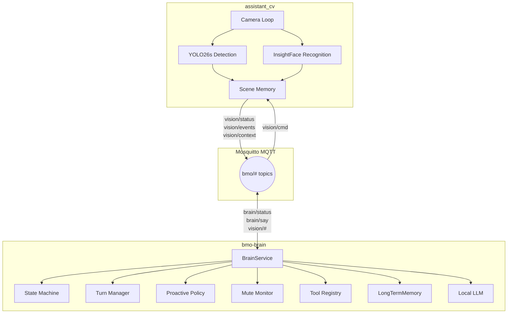

<p align="center">
  
</p>

<h1 align="center">BMO Assistant</h1>

<p align="center">
  <em>An embodied AI companion and conversational desktop assistant</em>
</p>

<p align="center">
  <a href="#-quick-start">Quick Start</a> •
  <a href="#-features">Features</a> •
  <a href="#-architecture">Architecture</a> •
  <a href="#-mqtt-topics">MQTT Topics</a> •
  <a href="#-testing">Testing</a>
</p>

---

## 🤖 Meet BMO

**BMO** (pronounced **Bee-M-O**) is your personal desktop companion — a friendly face that lives on your screen, sees through your camera, hears your voice, and remembers the people and things you introduce.

<div align="center">
  
  
  
</div>

---

## ✨ Features

| Feature | Description |
|---------|-------------|
| 👁️ **Computer Vision** | Real-time face recognition (InsightFace) + object/person detection (YOLO26s) |
| 🎤 **Voice Interface** | Wake word ("Hey Bee MO"), VAD, Whisper STT, Piper TTS |
| 🧠 **LLM Brain** | Local llama.cpp/Ollama with tool-calling for memory & vision |
| 💾 **Persistent Memory** | Remembers people, objects, preferences, and facts across sessions |
| 😊 **Expressive Face** | 18 emotional SVG expressions with lip-sync |
| 🔌 **MQTT Integration** | Clean pub/sub between vision, brain, and tools |
| 💻 **Laptop Native** | Runs entirely on your machine — no Pi/ESP32 needed |

---

## 🚀 Quick Start

### Prerequisites
- Python 3.11+
- CUDA-capable GPU (for LLM & face recognition)
- Webcam
- Microphone & speakers

### Installation

```bash
# Clone and enter
git clone <your-repo> && cd bmo-assistant

# Create venv and install
python -m venv .venv
source .venv/bin/activate
pip install -e .

# Download model weights (one-time)
.venv/bin/python tools/fetch_assets.py
```

### Run Everything

```bash
# Terminal 1: MQTT Broker
mosquitto -c /etc/mosquitto/mosquitto.conf

# Terminal 2: Vision Pipeline (camera + face/object detection)
.venv/bin/python -m assistant_cv.main

# Terminal 3: Brain Service (voice + LLM + memory)
.venv/bin/python -m brain.main
```

Or use the unified launcher:

```bash
.venv/bin/python run_all.py
```

### Systemd (Linux)

```bash
# Install user services
mkdir -p ~/.config/systemd/user
cp deploy/systemd/*.service ~/.config/systemd/user/

# Start all services
systemctl --user daemon-reload
systemctl --user start bmo-broker bmo-cv bmo-brain

# Enable on boot
systemctl --user enable bmo-broker bmo-cv bmo-brain
```

---

## 🏗️ Architecture



**Three processes, one MQTT bus:**
- **assistant_cv** — camera, detection, face ID, scene memory
- **bmo-brain** — wake word, STT/TTS, LLM, dialogue, memory, policy
- **mosquitto** — message broker (localhost:1883)

---

## 📡 MQTT Topics

| Topic | Direction | QoS | Retain | Description |
|-------|-----------|-----|--------|-------------|
| `bmo/vision/status` | cv → brain | 1 | ✓ | Camera online + LWT |
| `bmo/vision/events` | cv → brain | 1 | ✗ | Face/person/object events |
| `bmo/vision/context` | cv → brain | 0 | ✓ | Current scene (people, objects) |
| `bmo/vision/cmd` | brain → cv | 1 | ✗ | Enroll, forget, look, modules |
| `bmo/vision/cmd_result` | cv → brain | 1 | ✗ | Command acknowledgments |
| `bmo/brain/status` | brain → cv | 1 | ✓ | Brain state (idle/listening/thinking/speaking/muted) |
| `bmo/brain/say` | brain → TTS | 1 | ✗ | Utterances with emotion |

All topics defined in [`bmo_contracts/topics.py`](bmo_contracts/bmo_contracts/topics.py), payloads in [`models.py`](bmo_contracts/bmo_contracts/models.py).

---

## 💬 Usage Examples

**Wake BMO:**
> "Hey Bee MO, what time is it?"

**Introduce someone:**
> "Hey Bee MO, this is my friend Alice."
> *BMO enrolls Alice's face and remembers her.*

**Teach an object:**
> "Hey Bee MO, remember this is my favorite blue mug."
> *BMO saves "blue mug" to long-term memory.*

**Ask about memory:**
> "Hey Bee MO, who have you met today?"
> *BMO lists remembered people from persistent memory.*

**Mute/Unmute:**
> Press the mute key or send `{"kind": "mute_switch", "value": true}` to BMO's input.

---

## 🧪 Testing

```bash
# Contract validation
.venv/bin/python -m pytest tests/test_t01_contracts.py -v

# Full fast suite (no GPU/hardware/broker)
.venv/bin/python -m pytest -m "not gpu and not slow and not hw and not broker" -q

# Acceptance gates
.venv/bin/python tools/check_acceptance.py

# Lint & format
.venv/bin/ruff check --select F,ARG,ERA,B bmo_contracts brain tools tests
.venv/bin/ruff format --check bmo_contracts brain tools tests
```

---

## 📁 Project Structure

```
bmo-assistant/
├── assistant_cv/       # Vision pipeline (camera, YOLO, InsightFace, MQTT bridge)
├── brain/              # Brain service (audio, LLM, memory, policy, tools)
├── bmo_contracts/      # MQTT topic & payload definitions (Pydantic)
├── face_ui/            # BMO animated face (PyGame, 18 expressions)
├── config/             # YAML settings (audio, LLM, policy, scene)
├── deploy/             # systemd service files
├── docs/               # Contracts specification
├── tests/              # Unit, integration, contract tests
├── tools/              # Asset fetch, mock CV, broker, benchmarking
└── run_all.py          # Unified launcher
```

---

## 🙏 Acknowledgements

- **InsightFace** — face detection & recognition
- **Ultralytics YOLO** — object detection
- **faster-whisper** — speech-to-text
- **Piper TTS** — text-to-speech
- **openWakeWord** — wake word detection
- **llama.cpp / Ollama** — local LLM inference
- **Mosquitto** — MQTT broker

---

<p align="center">
  
  <br>
  <em>Built with ❤️ for local-first AI companionship</em>
</p>