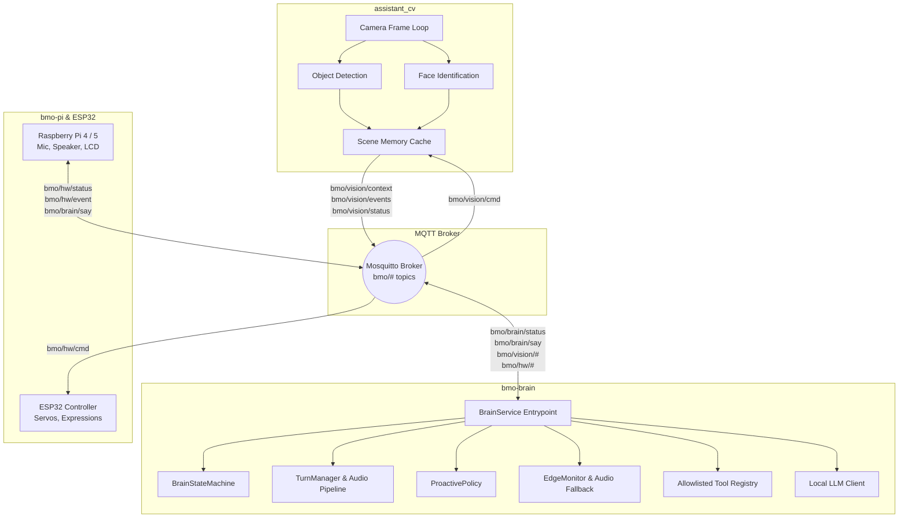

# BMO Assistant

An embodied AI companion and conversational desktop assistant powered by on-device computer vision, local speech pipeline (Wake Word, VAD, STT, TTS), LLM dialogue orchestration, and edge microcontrollers.

---

## 1. System Architecture



---

## 2. MQTT Topic Contracts & Roles

All topic constants are centralized in `bmo_contracts.topics` and payload models in `bmo_contracts.models`.

| Topic Constant | Topic Path | Direction / Role | QoS | Retain | Description |
|---|---|---|:---:|:---:|---|
| `VISION_STATUS` | `bmo/vision/status` | cv → all (`brain`, `pi`) | 1 | Yes | Camera subsystem online status (with LWT) |
| `VISION_EVENTS` | `bmo/vision/events` | cv → `brain` | 1 | No | Discrete perception events (face, person, object) |
| `VISION_CONTEXT` | `bmo/vision/context` | cv → `brain` | 0 | Yes | Current scene summary context (people, objects) |
| `VISION_CMD` | `bmo/vision/cmd` | `brain` → cv | 1 | No | Vision management commands (`enroll`, `forget`, etc.) |
| `VISION_CMD_RESULT` | `bmo/vision/cmd_result` | cv → `brain` | 1 | No | Handshake reply for vision commands |
| `BRAIN_STATUS` | `bmo/brain/status` | `brain` → all (`cv`, `pi`) | 1 | Yes | Brain state (`idle`, `listening`, `thinking`, `speaking`, `muted`) |
| `BRAIN_SAY` | `bmo/brain/say` | `brain` → `pi` | 1 | No | Spoken output utterances with assigned emotion |
| `HW_CMD` | `bmo/hw/cmd` | `brain` → `pi`, `esp32` | 1 | No | Actuator hardware commands (`move_servo`, `set_expression`) |
| `HW_STATUS` | `bmo/hw/status` | `pi`, `esp32` → `brain` | 1 | Yes | Hardware heartbeat and peripheral capability reporting |
| `HW_EVENT` | `bmo/hw/event` | `pi`, `esp32` → `brain` | 1 | No | Hardware switch and button events (e.g. `mute_switch`) |

---

## 3. Service Startup & Operations

### CLI Direct Execution

Start the core BMO brain service directly from the virtual environment:

```bash
# Start Brain Service against default local broker (127.0.0.1:1883)
.venv/bin/python -m brain.main

# Start with custom broker endpoint
.venv/bin/python -m brain.main --host 127.0.0.1 --port 1883
```

### Systemd User Services

User services preserve desktop session access (PipeWire / ALSA audio devices):

```bash
# Link or install unit files to systemd user directory
mkdir -p ~/.config/systemd/user
cp deploy/systemd/*.service ~/.config/systemd/user/

# Reload user daemon
systemctl --user daemon-reload

# Start broker, vision, brain, and edge peers
systemctl --user start bmo-broker bmo-cv bmo-brain bmo-pi

# Enable services to run on boot
systemctl --user enable bmo-broker bmo-cv bmo-brain bmo-pi

# Check service status
systemctl --user status bmo-brain
```

---

## 4. Verification & Testing

Run all unit, integration, and repository hygiene tests inside `.venv`:

```bash
# Run repository hygiene and contract validation
.venv/bin/python -m pytest tests/test_hygiene.py tests/test_t01_contracts.py -v

# Run End-to-End System test suite
.venv/bin/python -m pytest tests/test_e2e_system.py -v

# Run full fast test suite
.venv/bin/python -m pytest -m "not gpu and not slow and not hw and not broker" -q

# Run all 40 task acceptance gates verification
.venv/bin/python tools/check_acceptance.py

# Linting and formatting checks
.venv/bin/ruff check --select F,ARG,ERA,B bmo_contracts brain edge tools evals tests
.venv/bin/ruff format --check bmo_contracts brain edge tools evals tests
.venv/bin/vulture bmo_contracts brain edge tools evals --min-confidence 80
```
