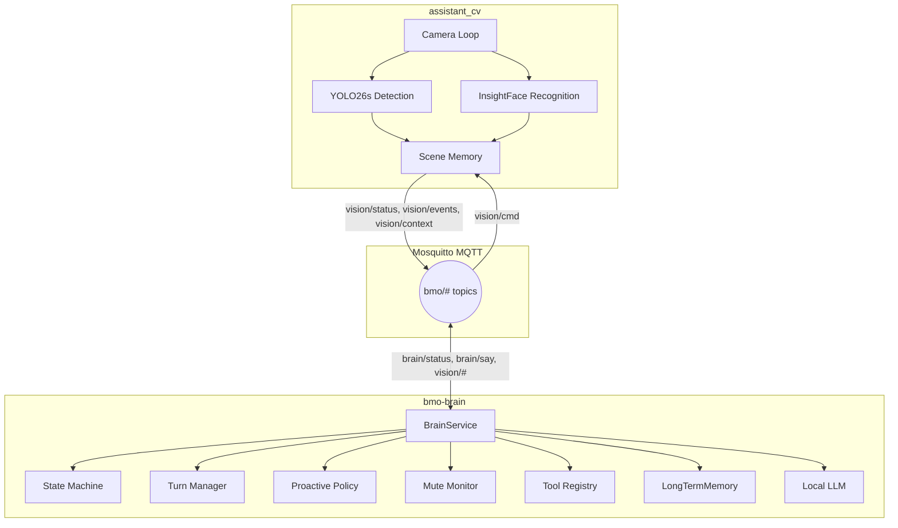

<p align="center">
  
</p>

<h1 align="center">BMO Assistant</h1>

<p align="center">
  An embodied AI companion that lives on your desktop
</p>

<p align="center">
  <a href="#quick-start">Quick Start</a> |
  <a href="#features">Features</a> |
  <a href="#architecture">Architecture</a> |
  <a href="#mqtt-topics">MQTT Topics</a> |
  <a href="#testing">Testing</a>
</p>

---

## What is this

BMO (pronounced BEE-M-O) is a desktop companion I built for a personal project. It has a face that shows expressions, it can see through your webcam, hear you through the microphone, and talk back using text-to-speech. It remembers people you introduce and objects you teach it.

The name comes from the character BMO from Adventure Time - a small sentient game console. This BMO runs entirely on your laptop, no extra hardware needed.

<div align="center">
  
  
  
</div>

---

## Features

| Feature | What it does |
|---------|--------------|
| Computer Vision | Face recognition with InsightFace, object and person detection with YOLO26s |
| Voice Interface | Wake word "Hey BMO", voice activity detection, Whisper speech-to-text, Piper text-to-speech |
| LLM Brain | Local llama.cpp or Ollama with tool calling for memory and vision |
| Persistent Memory | Remembers people, objects, preferences, and facts across sessions |
| Expressive Face | 18 emotional SVG expressions with lip sync |
| MQTT Integration | Clean pub/sub between vision, brain, and tools |
| Laptop Native | Runs entirely on your machine, no Raspberry Pi or ESP32 needed |

---

## Quick Start

### What you need
- Python 3.11 or newer
- CUDA-capable GPU (for the LLM and face recognition)
- A webcam
- Microphone and speakers

### Installation

```bash
# Clone the repo
git clone <your-repo> && cd bmo-assistant

# Set up virtual environment
python -m venv .venv
source .venv/bin/activate
pip install -e .

# Download model weights (first time only)
.venv/bin/python tools/fetch_assets.py
```

### Model Downloads

Heavy model files are **not included in the repo** — they download on first run via `fetch_assets.py`:

| Model | Purpose | Size | Location |
|-------|---------|------|----------|
| LLM (GGUF) | Local language model | ~2.6 GB | `models/` |
| YOLO26s | Object/person detection | ~50 MB | `assistant_cv/models/` |
| YOLO-World | Open-vocabulary detection | ~50 MB | `assistant_cv/models/` |
| InsightFace (SCRFD + ArcFace) | Face detection + recognition | ~200 MB | `assistant_cv/models/` |
| Piper voice (BMO) | Custom text-to-speech | ~61 MB | `models/piper/` |
| openWakeWord | Wake word detection | ~15 MB | `openwakeword/resources/` |
| Whisper (base.en) | Speech-to-text | ~140 MB | HF cache |
| Silero VAD | Voice activity detection | ~10 MB | HF cache |

**Total download: ~3 GB** — requires internet on first run.

If `fetch_assets.py` fails, you can download manually from the sources listed in `tools/fetch_assets.py`.

### Running it

You need three terminals:

```bash
# Terminal 1: MQTT broker
mosquitto -c /etc/mosquitto/mosquitto.conf

# Terminal 2: Vision pipeline (camera, detection, face ID)
.venv/bin/python -m assistant_cv.main

# Terminal 3: Brain service (voice, LLM, memory)
.venv/bin/python -m brain.main
```

Or just run everything at once:

```bash
.venv/bin/python run_all.py
```

### Systemd (if you are on Linux)

```bash
mkdir -p ~/.config/systemd/user
cp deploy/systemd/*.service ~/.config/systemd/user/

systemctl --user daemon-reload
systemctl --user start bmo-broker bmo-cv bmo-brain
systemctl --user enable bmo-broker bmo-cv bmo-brain
```

---

## Architecture



Three processes talking over one MQTT bus:
- **assistant_cv** handles the camera, runs detection and face recognition, publishes scene updates
- **bmo-brain** handles wake word, speech-to-text, LLM, text-to-speech, dialogue, memory, and policy
- **mosquitto** is the message broker running on localhost:1883

---

## MQTT Topics

| Topic | Direction | QoS | Retain | Description |
|-------|-----------|-----|--------|-------------|
| bmo/vision/status | cv to brain | 1 | Yes | Camera online status with LWT |
| bmo/vision/events | cv to brain | 1 | No | Face, person, object events |
| bmo/vision/context | cv to brain | 0 | Yes | Current scene (people, objects) |
| bmo/vision/cmd | brain to cv | 1 | No | Commands like enroll, forget, look |
| bmo/vision/cmd_result | cv to brain | 1 | No | Command acknowledgments |
| bmo/brain/status | brain to cv | 1 | Yes | Brain state (idle, listening, thinking, speaking, muted) |
| bmo/brain/say | brain to TTS | 1 | No | Utterances with emotion |

All topics are defined in `bmo_contracts/topics.py`, payloads in `bmo_contracts/models.py`.

---

## How to use it

**Wake BMO:**
> "Hey BMO, what time is it?"

**Introduce someone:**
> "Hey BMO, this is my friend Alice."
BMO enrolls Alice's face and remembers her.

**Teach an object:**
> "Hey BMO, remember this is my blue mug."
BMO saves "blue mug" to long-term memory.

**Ask about memory:**
> "Hey BMO, who have you met today?"
BMO lists remembered people from persistent memory.

**Mute or unmute:**
Press the mute key or send `{"kind": "mute_switch", "value": true}` to BMO's input.

---

## Testing

```bash
# Contract validation
.venv/bin/python -m pytest tests/test_t01_contracts.py -v

# Fast test suite (no GPU, hardware, or broker needed)
.venv/bin/python -m pytest -m "not gpu and not slow and not hw and not broker" -q

# Acceptance gates
.venv/bin/python tools/check_acceptance.py

# Linting and formatting
.venv/bin/ruff check --select F,ARG,ERA,B bmo_contracts brain tools tests
.venv/bin/ruff format --check bmo_contracts brain tools tests
```

---

## Project Structure

```
bmo-assistant/
assistant_cv/       # Vision pipeline (camera, YOLO, InsightFace, MQTT bridge)
brain/              # Brain service (audio, LLM, memory, policy, tools)
bmo_contracts/      # MQTT topic and payload definitions (Pydantic)
face_ui/            # BMO animated face (PyGame, 18 expressions)
config/             # YAML settings (audio, LLM, policy, scene)
deploy/             # systemd service files
docs/               # Contracts specification
tests/              # Unit, integration, contract tests
tools/              # Asset fetch, mock CV, broker, benchmarking
run_all.py          # Unified launcher
```

---

## Acknowledgements

- InsightFace for face detection and recognition
- Ultralytics YOLO for object detection
- faster-whisper for speech-to-text
- Piper TTS for text-to-speech
- openWakeWord for wake word detection
- llama.cpp and Ollama for local LLM inference
- Mosquitto for MQTT broker
- BMO face templates from [Figma Community](https://www.figma.com/community/file/1379945530999597632/bmo-face-templates-assets)
- BMO voice model from [brenpoly/be-more-agent](https://github.com/brenpoly/be-more-agent/releases/tag/v1.0-voice)

---

<p align="center">
  
  <br>
  Built for local-first AI companionship
</p>