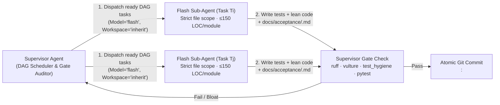

# BMO Assistant: Multi-Agent Execution Plan (Single-Venv Supervisor Edition)

## 0. Mission & Scope

Build the **BMO brain** (voice, dialogue, tools), link it to the verified `assistant_cv/` vision suite over MQTT, and connect the Raspberry Pi / ESP32 body—all within the **single existing `.venv` (Python 3.14.8)** under strict anti-bloat, zero-stale-state engineering gates supervised across **Gemini Flash (`Model="flash"`) sub-agents**.

**Non-goals (deferred):** speaker ID, facial-expression recognition, long-term memory beyond the 60 s scene memory, multilingual replies, custom "BMO" wake word.

---

## User Review Required: 6 Grounded Improvements Identified During Codebase Audit

> [!IMPORTANT]
> **Audit Findings & Plan Improvements (Verified Against Live Repo & `.venv`)**
>
> 1. **`openwakeword` Resolver Trap (`T0.4`)**:
>    - Without `tflite-runtime` in `requirements/overrides.txt`, `uv` downgrades `openwakeword` to `0.4.0` (from 2022), which **lacks `inference_framework="onnx"`** required by `T3.2`.
>    - **Fix**: Add `tflite-runtime; sys_platform == "never"` alongside `onnxruntime; sys_platform == "never"` in `requirements/overrides.txt` and pin `openwakeword>=0.6.0`. Verified via `uv pip install --dry-run`: resolves `openwakeword==0.6.0` in 32 ms.
> 2. **`uv pip check` False-Positives on `.venv` (`T0.4` & `test_hygiene.py`)**:
>    - Running bare `uv pip check` on `.venv` *already* exits 1 because `ultralytics` and `insightface` declare `opencv-python` and `onnxruntime`, whereas `.venv` intentionally uses `opencv-contrib-python` and `onnxruntime-gpu`.
>    - **Fix**: Instead of bare `uv pip check`, `tests/test_hygiene.py` runs `uv pip check` and asserts that the **only** reported missing packages are the 3 intentional overrides (`onnxruntime`, `opencv-python`, `tflite-runtime`), while verifying `onnxruntime-gpu` and `opencv-contrib-python` remain intact.
> 3. **Existing `"bmo/` Topic Literals vs. `test_hygiene.py` (`T0.1` & `T2.3`)**:
>    - Currently, `"bmo/vision/..."` string literals exist in [assistant_cv/config.py](file:///home/judas/bmo-assistant/assistant_cv/config.py), [tools/mqtt_client.py](file:///home/judas/bmo-assistant/tools/mqtt_client.py), [tests/test_mqtt_commands.py](file:///home/judas/bmo-assistant/tests/test_mqtt_commands.py), and [tests/test_pipeline_upgrades.py](file:///home/judas/bmo-assistant/tests/test_pipeline_upgrades.py).
>    - **Fix**: In `T0.1`, Agent A creates `tests/test_hygiene.py` and updates those 4 files to import topic constants from `bmo_contracts.topics` (including temporary legacy aliases `TOPIC_VISION_CMD_LEGACY` / `TOPIC_VISION_RESP_LEGACY`). Then in `T2.3`, Agent G removes those legacy aliases and migrates `main.py`, `mqtt_bridge.py`, `tools/mqtt_client.py`, and tests to `VisionCmd` / `VisionCmdResult`. This makes `test_hygiene.py` pass from `T0.1` onward with zero exceptions.
> 4. **`EventDetector` Payload Conformance (`T0.1` & `T2.6`)**:
>    - In [assistant_cv/main.py](file:///home/judas/bmo-assistant/assistant_cv/main.py#L440-L506), `EventDetector` currently emits `"object_detected"` / `"object_removed"` instead of `"object_seen"`, uses `"sign"` instead of `"text"` in `sign_recognized`, and omits `track_id`/`pos`/`proximity` on `person_detected`.
>    - **Fix**: Include `EventDetector` and context-on-change (`<= 1 Hz`) in `T0.1`'s CV conformance hook so `assistant_cv` emits 100% schema-valid `bmo_contracts.Event` and `Scene` payloads immediately, guaranteeing `T2.6` live conformance passes without backtracking.
> 5. **Linter/Vulture Scope vs. Untouched `assistant_cv/` Files (Section 3.4)**:
>    - Running `ruff format --check .` and `ERA` (commented-out code) across untouched files in `assistant_cv/` (which sub-agents are forbidden to edit per Section 9) would fail on pre-existing comments in `objects.py`, `faces.py`, etc.
>    - **Fix**: Configure `pyproject.toml` (or `ruff.toml`) so `ruff` and `vulture` enforce strict `F,ARG,ERA,B` and formatting on all new packages (`bmo_contracts`, `brain`, `edge`, `tools`, `evals`, `tests`) plus the 3 allowed `assistant_cv` hook files (`mqtt_bridge.py`, `memory.py`, `main.py`), with `_on_connect`/`_on_message`/`_on_disconnect`/`_on_socket_open` paho-mqtt callback signatures whitelisted via `dummy-variable-rgx`.
> 6. **Host OS Commands (`Section 11` Human Actions)**:
>    - The host OS is **Omarchy 4.0.6 (Arch Linux)** (`pacman`, not `apt`). Currently `ollama`, `mosquitto`, and `arduino-cli` are not installed.
>    - **Fix**: Update `H1`/`H2` commands to `sudo pacman -S mosquitto ollama-cuda` (and allow `T5.5` to fetch the static `arduino-cli` binary to `~/.local/bin/arduino-cli` in user-space if not installed globally).

---

## 1. Grounded Baseline

| Item | Value |
|---|---|
| Repo root | `/home/judas/bmo-assistant` |
| OS | Omarchy 4.0.6 (Arch Linux, `pacman`) |
| GPU | NVIDIA GTX 1660 Ti, 6144 MiB total, ~5762 MiB free idle, CUDA 13.2 |
| Python | **Single venv: `.venv` (Python 3.14.8) for all processes and tests.** |
| Existing CV | 35/35 unit tests pass, ~50 FPS decoupled loop |
| Audio | PipeWire 1.6.9 (PulseAudio compat), ALSA `card 2: ALC256 Analog` |
| Edge | Raspberry Pi (mic, speaker, LCD) + ESP32 (servos, LEDs; serial) |
| Tooling | `uv` at `/usr/bin/uv` |
| System Daemons | `mosquitto` and `ollama` not yet installed (`H1`, `H2` in Section 11) |

---

## 2. Supervisor & Gemini Flash Sub-Agent Architecture

To maximize throughput while preventing bloat, dead code, and git index collisions across `Model="flash"` sub-agents:



### Supervision Rules for `Model="flash"` Sub-Agents
1. **Granular 1-Task Dispatch**: Invoke a fresh `Model="flash"` sub-agent per individual task (`T<phase>.<n>`) rather than bundling 5 tasks into one long context. Short, surgical prompts keep Flash sub-agents fast, accurate, and deterministic.
2. **Supervisor-Controlled Git Operations**:
   - Concurrent Flash sub-agents in `Workspace="inherit"` must **never** run `git switch` or `git commit` themselves (which causes `.git/index.lock` races when two sub-agents run in parallel).
   - Instead, each parallel sub-agent edits **only** its disjoint owned files (Section 8) and runs pytest on its test file.
   - The **Supervisor** reviews the diff for bloat/dead code, runs the full Section 3.4 gate suite, and performs the atomic branch/commit (`<ID>: <summary>`).
3. **Strict Anti-Bloat & Line-Budget Guardrails**:
   - Every sub-agent prompt includes an explicit **LOC ceiling** (typically 50–150 lines per module) and forbids speculative abstractions, unused helper classes, decorator frameworks, or wrapper layers not required by the task.
   - Use Python `Protocol` or simple dataclasses/Pydantic models; never write boilerplate factory classes when a dictionary or function suffices.

---

## 3. Engineering Rules (Enforced on Every Task)

### 3.1 One Source of Truth (Zero Duplication)
- **Topics & ACLs**: Topic strings, QoS, retain flags, and role pub/sub rights exist **only** in `bmo_contracts/topics.py`. Payload schemas exist **only** in `bmo_contracts/models.py`. `infra/acl` is generated from `topics.py` by `tools/gen_acl.py`.
- **Tunables**: Thresholds, cooldowns, timeouts, `keep_alive`, debounce, and `max_age` live **only** in `config/settings.d/*.yaml`, loaded once by `brain/settings.py` into a frozen typed `Settings` object injected via constructors.
- **Physical Limits**: Servo ranges, slew rate, rate limits, and the `Emotion` enum values live **only** in `config/limits.yaml`, read by `brain/tools/actuator_tools.py`, `edge/emotions.py`, and `tools/gen_limits_header.py`.
- **Dependencies**: Declared **only** in `requirements/`.

### 3.2 No Stale State
- **Code**: Zero unused variables, imports, parameters, functions, or files. Zero commented-out code. Zero names like `old`, `v2`, `tmp`, `new_`.
- **Runtime**: Every cached value carries a timestamp from an injected monotonic clock (`Callable[[], float]`, defaulting to `time.monotonic`) and a maximum age. All derived state (scene cache, cooldowns, debounce windows, enrollment lock, `pending_confirmation`) resets on MQTT reconnect, vision offline, privacy mute, and turn cancel.
- **Ownership**: Zero module-level mutable globals.

### 3.3 Machine-Checkable Gates (Run Before Every Commit)
```bash
.venv/bin/ruff check --select F,ARG,ERA,B bmo_contracts brain edge tools evals tests assistant_cv/mqtt_bridge.py assistant_cv/memory.py assistant_cv/main.py
.venv/bin/ruff format --check bmo_contracts brain edge tools evals tests assistant_cv/mqtt_bridge.py assistant_cv/memory.py assistant_cv/main.py
.venv/bin/vulture bmo_contracts brain edge tools evals assistant_cv/mqtt_bridge.py assistant_cv/memory.py --min-confidence 80
.venv/bin/python -m pytest tests/test_hygiene.py -q
.venv/bin/python -m pytest -m "not gpu and not slow and not hw and not broker" -q
```
`tests/test_hygiene.py` fails if:
1. Any `"bmo/` literal appears in any `.py` file outside `bmo_contracts/topics.py`.
2. `.venv-brain` or `python3.12` is referenced anywhere in the repo.
3. Any top-level tunable key is defined in more than one `config/settings.d/*.yaml` file.
4. `requirements.lock.txt` differs from `uv pip freeze --python .venv/bin/python`.
5. `uv pip check --python .venv/bin/python` reports any incompatibility outside `{onnxruntime, opencv-python, tflite-runtime}` or if plain `onnxruntime` / `opencv-python` is installed.
6. `infra/acl` differs from `tools/gen_acl.py` output (once `T0.2` is merged).
7. `FakeLLMBackend` is imported anywhere in `brain/` outside `brain/llm.py`.

---

## 4. Contracts (`bmo_contracts/`, Built in `T0.1`)

### 4.1 Topics Registry (`bmo_contracts/topics.py`)

| Constant | Topic | Dir | QoS | Retain | Model | Pub Roles | Sub Roles |
|---|---|---|---|---|---|---|---|
| `VISION_STATUS` | `bmo/vision/status` | cv → all | 1 | yes (+LWT) | `VisionStatus` | `cv` | `brain`, `pi` |
| `VISION_EVENTS` | `bmo/vision/events` | cv → brain | 1 | no | `Event` | `cv` | `brain` |
| `VISION_CONTEXT` | `bmo/vision/context` | cv → brain | 0 | yes | `Scene` | `cv` | `brain` |
| `VISION_CMD` | `bmo/vision/cmd` | brain → cv | 1 | no | `VisionCmd` | `brain` | `cv` |
| `VISION_CMD_RESULT` | `bmo/vision/cmd_result` | cv → brain | 1 | no | `VisionCmdResult` | `cv` | `brain` |
| `BRAIN_STATUS` | `bmo/brain/status` | brain → all | 1 | yes (+LWT) | `BrainStatus` | `brain` | `cv`, `pi` |
| `BRAIN_SAY` | `bmo/brain/say` | brain → pi | 1 | no | `BrainSay` | `brain` | `pi` |
| `HW_CMD` | `bmo/hw/cmd` | brain → edge | 1 | no | `HwCmd` | `brain` | `pi`, `esp32` |
| `HW_STATUS` | `bmo/hw/status` | edge → all | 1 | yes (+LWT) | `HwStatus` | `pi`, `esp32` | `brain` |
| `HW_EVENT` | `bmo/hw/event` | edge → brain | 1 | no | `HwEvent` | `pi`, `esp32` | `brain` |

### 4.2 Models (`bmo_contracts/models.py`, Pydantic v2, `extra="forbid"`)

```python
class Model(BaseModel):
    model_config = ConfigDict(extra="forbid")

class Emotion(StrEnum):
    NEUTRAL = "neutral"; HAPPY = "happy"; SAD = "sad"; THINKING = "thinking"
    SURPRISED = "surprised"; SLEEPY = "sleepy"; WINK = "wink"; ERROR = "error"

class VisionStatus(Model): online: bool
class BrainStatus(Model):  online: bool; state: Literal["idle", "listening", "thinking", "speaking", "muted", "error"]
class HwStatus(Model):     online: bool; ts: float; capabilities: list[str]
class HwEvent(Model):      ts: float; kind: Literal["mute_switch"]; value: bool

class FaceData(Model):     track_id: int | None = None; name: str; conf: float
class PersonData(Model):   track_id: int | None = None; pos: Literal["left", "center", "right"]; proximity: Literal["near", "medium", "far"]
class PersonLeftData(Model): track_id: int | None = None
class SignData(Model):     text: str; conf: float
class ObjectData(Model):   label: str; conf: float

class FaceIdentified(Model): v: Literal[1] = 1; id: str; ts: float; type: Literal["face_identified"] = "face_identified"; data: FaceData
class PersonDetected(Model): v: Literal[1] = 1; id: str; ts: float; type: Literal["person_detected"] = "person_detected"; data: PersonData
class PersonLeft(Model):     v: Literal[1] = 1; id: str; ts: float; type: Literal["person_left"] = "person_left"; data: PersonLeftData
class SignRecognized(Model): v: Literal[1] = 1; id: str; ts: float; type: Literal["sign_recognized"] = "sign_recognized"; data: SignData
class ObjectSeen(Model):     v: Literal[1] = 1; id: str; ts: float; type: Literal["object_seen"] = "object_seen"; data: ObjectData

Event = Annotated[FaceIdentified | PersonDetected | PersonLeft | SignRecognized | ObjectSeen, Field(discriminator="type")]
EVENT_ADAPTER = TypeAdapter(Event)

class ScenePerson(Model):
    track_id: int | None
    name: str
    pos: Literal["left", "center", "right"]
    proximity: Literal["near", "medium", "far"]
    since_s: float

class LastSign(Model): text: str; age_s: float
class Scene(Model):    ts: float; people: list[ScenePerson]; objects: list[str]; last_sign: LastSign | None = None; recent: list[str]

class VisionCmd(Model):       id: str; cmd: Literal["enroll", "forget", "reload_gallery", "set_modules"]; args: dict[str, Any] = {}
class VisionCmdResult(Model): id: str; ok: bool; detail: str
class BrainSay(Model):        utt_id: str; text: str; emotion: Emotion
class HwCmd(Model):           id: str; target: Literal["pi", "esp32"]; action: Literal["set_expression", "move_servo", "play_sound"]; args: dict[str, Any] = {}
```

---

## 5. Task Graph & Execution Specifications (40 Tasks)

### Phase 0: Foundations (`CP0`)

#### T0.1 Contracts package and CV conformance
- **deps**: none · **owner**: A
- **files**: `bmo_contracts/**` (`pyproject.toml`, `__init__.py`, `models.py`, `topics.py`), `pytest.ini`, `ruff.toml`, `docs/contracts.md`, `assistant_cv/config.py`, `assistant_cv/memory.py`, `assistant_cv/mqtt_bridge.py`, `assistant_cv/main.py` (EventDetector & context-on-change hooks), `tools/mqtt_client.py`, `tests/test_mqtt_commands.py`, `tests/test_pipeline_upgrades.py`, `tests/test_hygiene.py`, `tests/test_t01_contracts.py`
- **do**:
  1. Implement `bmo_contracts` (Section 4) and install editable into `.venv`.
  2. Configure `pytest.ini` (markers: `gpu`, `slow`, `hw`, `broker`) and `ruff.toml` + `tests/test_hygiene.py`.
  3. Replace `"bmo/..."` literals in `assistant_cv/config.py`, `tools/mqtt_client.py`, `tests/test_mqtt_commands.py`, and `tests/test_pipeline_upgrades.py` with imports from `bmo_contracts.topics`.
  4. Add `ShortTermMemory.get_scene_contract()` in `assistant_cv/memory.py` mapping `"close" -> "near"`, computing `since_s: float`, `objects: list[str]`, `last_sign`, and `recent` (≤ 300 tokens).
  5. Update `assistant_cv/mqtt_bridge.py` and `EventDetector` in `assistant_cv/main.py` so LWT & `online: true` publish `VisionStatus` on `bmo/vision/status`, `EventDetector` emits validated `Event` models on `bmo/vision/events`, and `Scene` publishes retained on `bmo/vision/context` on change (≤ 1 Hz).
- **accept**: every Section 4.3 example validates; malformed/extra-field payloads rejected; `test_hygiene.py` passes; existing 35 CV tests pass; headless CV run ≥ 20 FPS.

#### T0.2 Broker config and ACL enforcement
- **deps**: T0.1 · **owner**: B
- **files**: `tools/gen_acl.py`, `infra/mosquitto.conf`, `infra/acl` (generated), `infra/passwords.example`, `tools/simple_broker.py`, `tests/test_t02_broker_acl.py`
- **do**: `allow_anonymous false`, password file, LAN listener in `infra/mosquitto.conf`. `tools/gen_acl.py` generates `infra/acl` from `bmo_contracts/topics.py`. Enhance `tools/simple_broker.py` to enforce authentication and topic read/write ACLs parsed from `infra/passwords` and `infra/acl`.
- **accept**: parametrized tests over `simple_broker` (always runs) and `mosquitto` (marker `broker`, skipped when binary absent): unauthenticated connect refused; `brain` cannot publish `bmo/vision/events`; `pi` cannot publish `bmo/hw/cmd`.

#### T0.3 Mock harness and contract round-trip
- **deps**: T0.1, T0.2 · **owner**: D
- **files**: `tools/mock_cv.py`, `tools/mock_pi.py`, `tests/test_contracts_roundtrip.py`
- **do**: `mock_cv` publishes scripted `VisionStatus`, `Event`, `Scene` and responds to `VisionCmd` with `VisionCmdResult`. `mock_pi` publishes `HwStatus`/`HwEvent` and validates received `BrainSay`/`HwCmd`.
- **accept**: round-trip test iterates `TOPICS` in `bmo_contracts/topics.py` (no hard-coded topic count) and passes 100% schema validation.

#### T0.4 Install speech/LLM dependencies into the existing `.venv`
- **deps**: none · **owner**: C
- **files**: `requirements/overrides.txt`, `requirements/brain.txt`, `requirements/dev.txt`, `requirements/snapshot_pre_T0.4.txt`, `requirements.lock.txt`, `docs/env.md`
- **do**:
  ```bash
  uv pip freeze --python .venv/bin/python > requirements/snapshot_pre_T0.4.txt
  printf 'onnxruntime; sys_platform == "never"\ntflite-runtime; sys_platform == "never"\n' > requirements/overrides.txt
  uv pip install --python .venv/bin/python --override requirements/overrides.txt -r requirements/brain.txt
  uv pip install --python .venv/bin/python --override requirements/overrides.txt -r requirements/dev.txt
  uv pip install --python .venv/bin/python --override requirements/overrides.txt -e ./bmo_contracts
  uv pip freeze --python .venv/bin/python > requirements.lock.txt
  ```
  `brain.txt`: `faster-whisper`, `openwakeword>=0.6.0`, `silero-vad`, `piper-tts`, `sounddevice`, `ollama`, `httpx`, `paho-mqtt`, `orjson`, `pydantic`, `pyyaml`, `pytest`. `dev.txt`: `ruff`, `vulture`.
- **accept**: all imports succeed; `onnxruntime.get_available_providers()` contains `CUDAExecutionProvider`; `uv pip list` shows `onnxruntime-gpu` and no plain `onnxruntime`; `torch`, `numpy`, `opencv-contrib-python`, `onnxruntime-gpu` versions unchanged from snapshot; `torch.cuda.is_available()` is True; 35 CV tests pass.

#### T0.5 VRAM baseline probe
- **deps**: none · **owner**: C
- **files**: `tools/vram_probe.py`, `docs/acceptance/T0.5/vram_baseline.csv`
- **do**: poll per-process (`nvidia-smi --query-compute-apps`) and total GPU memory (`nvidia-smi --query-gpu=memory.used,memory.free`) at 1 Hz to CSV while `assistant_cv/main.py --headless --frames 180` runs.
- **accept**: CSV has ≥ 5 rows with the CV process; baseline recorded in `docs/acceptance/T0.5.md`.

#### T0.6 Model assets and functional smoke tests
- **deps**: T0.4, T1.1 · **owner**: C
- **files**: `tools/fetch_assets.py`, `tests/test_t06_assets_smoke.py` (marker `slow`), `docs/assets.md`
- **do**: verify Ollama is installed (escalate `H2` if absent; also support user-space `~/.local/bin/ollama` if present); download Piper voice (`en_US-lessac-medium.onnx`), openWakeWord ONNX models (`hey_jarvis_v0.1.onnx`, `melspectrogram.onnx`, `embedding_model.onnx`), and Faster-Whisper (`base.en`) to paths read from `Settings`.
- **accept** (against **real** engines): transcribe a test wav with Faster-Whisper; synthesize a phrase to wav with Piper; score a wav with openWakeWord ONNX; complete one LLM chat turn through Ollama.

---

### Phase 1: Text-Only Brain (`CP1`)

#### T1.1 LLM client and settings loader
- **deps**: T0.4 · **owner**: E
- **files**: `brain/__init__.py`, `brain/settings.py`, `brain/llm.py`, `config/settings.d/llm.yaml`, `tests/test_t11_llm.py`
- **do**: `brain/settings.py` loads `config/settings.d/*.yaml` into a frozen Pydantic `Settings` dataclass. `LLMClient.chat(messages, tools=None, stream=True, cancel_event=None)` with `OllamaBackend` (`num_ctx=4096`, `keep_alive` from settings, `think=False`), timeouts, token estimator, and cancellation checked between chunks. `FakeLLMBackend` allowed in unit tests only (guarded by `test_hygiene.py`).
- **accept**: streams tokens; emits tool calls; timeout handled; cancellation < 200 ms; hygiene test passes.

#### T1.2 Scene cache
- **deps**: T0.1, T0.3, T1.1 · **owner**: F
- **files**: `brain/scene.py`, `config/settings.d/scene.yaml`, `tests/test_t12_scene.py`
- **do**: subscribe to `bmo/vision/context` and `bmo/vision/status`, validate with `bmo_contracts`, use injected monotonic clock. Expose `latest()`, `age_s`, `is_stale` (offline or `age_s > max_age_s`), and `reset()`.
- **accept**: with `mock_cv`, `latest()` updates on change; `is_stale` flips immediately on `online: false` or clock advance past `max_age_s`.

#### T1.3 Prompt builder and rolling history
- **deps**: T1.1, T1.2 · **owner**: F
- **files**: `brain/prompt.py`, `tests/test_t13_prompt.py`
- **do**: system prompt: `"You are BMO, a friendly home assistant. Reply in 1-2 short sentences. SCENE is ground truth: never mention people or objects that are not in it. If unsure, say so."` Inject `SCENE` as compact JSON inside `<scene>...</scene>` delimiters (marked stale/offline when `is_stale`). Rolling history = last 8 turns; 4096-token budget evicts oldest history first, never system prompt or scene.
- **accept**: 100-iteration fuzz keeps total tokens ≤ 4096 with scene always present.

#### T1.4 Streaming sentence splitter
- **deps**: T1.1 · **owner**: E
- **files**: `brain/stream.py`, `tests/test_t14_stream.py`
- **do**: yield complete sentences from token streams as soon as boundaries are certain; handle abbreviations (`Mr.`, `Mrs.`, `Dr.`, `Prof.`, `St.`, `vs.`, `e.g.`, `i.e.`, `U.S.`), decimals (`3.14`), ellipses (`...`), and quotes.
- **accept**: ≥ 22 tricky cases pass; first sentence is emitted before the token generator finishes.

#### T1.5 Grounding eval set and runner (claim-based)
- **deps**: T1.3 · **owner**: F
- **files**: `evals/grounding.jsonl` (≥ 60 cases), `evals/run.py`, `tests/test_t15_evals.py`
- **do**: 60+ cases covering presence, absence, counts, positions, signs, empty scene, stale scene, and adversarial traps (`"Is Sara holding an umbrella?"`). Claim-based scoring uses a temperature-0 extraction prompt returning `{"people": [...], "objects": [...]}` of entities asserted as *present* in the reply, verifying `claimed_present ⊆ scene_present` and required entities are mentioned when asked.
- **accept**: runner prints per-case results and aggregate accuracy; unit tests verify claim-extractor scoring logic with canned replies (including negations like `"I don't see an umbrella"` passing).

#### T1.6 Model selection and benchmark record
- **deps**: T1.1, T1.5, T0.5, T0.6 · **owner**: F
- **files**: `tools/benchmark_llm.py`, `docs/decisions/llm.md`
- **do**: benchmark 2–3 current Ollama 3–4B tool-calling models (e.g. `qwen2.5:3b`, `llama3.2:3b`, `granite3.1-dense:2b`) with thinking off alongside running `assistant_cv`. Record grounding score, warm TTFT, tokens/s, and `peak_used_MiB`. Write winning model to `config/settings.d/llm.yaml`.
- **accept** (real model): grounding ≥ 90%, warm TTFT < 1.0 s, `peak_used_MiB <= 5300` with CV running ≥ 20 FPS.

---

### Phase 2: Tools & Actions (`CP2`)

#### T2.1 Allowlisted tool registry
- **deps**: T1.1, T0.1 · **owner**: G
- **files**: `brain/tools/__init__.py`, `brain/tools/schemas.py`, `brain/tools/registry.py`, `tests/test_t21_tool_registry.py`
- **do**: `ToolRegistry` holding `ToolSpec(name, description, schema, handler, risky=False)`. Validates tool name and Pydantic schema (`extra="forbid"`, max string lengths) before execution; returns `{"ok": False, "error": ...}` on invalid calls with zero side effects.
- **accept**: fuzz test (wrong types, extra fields, 100 KB strings, injection strings, unknown tools) 100% rejected with zero side effects.

#### T2.2 Read-only scene tools
- **deps**: T2.1, T1.2 · **owner**: G
- **files**: `brain/tools/scene_tools.py`, `tests/test_t22_scene_tools.py`
- **do**: `describe_scene()` and `find_object(name)` reading strictly from `SceneCache`.
- **accept**: outputs match scene fixtures exactly.

#### T2.3 Vision command handshake (migrates legacy topics)
- **deps**: T2.1, T0.3 · **owner**: G
- **files**: `brain/vision_client.py`, `bmo_contracts/topics.py`, `bmo_contracts/models.py`, `assistant_cv/config.py`, `assistant_cv/mqtt_bridge.py`, `assistant_cv/main.py`, `tools/mqtt_client.py`, `tests/test_mqtt_commands.py`, `tests/test_pipeline_upgrades.py`, `MQTT_GUIDE.md`, `tests/test_t23_vision_handshake.py`
- **do**:
  1. `VisionClient.send_cmd(cmd, args, timeout)` publishes `VisionCmd` on `bmo/vision/cmd` and awaits correlated `VisionCmdResult` on `bmo/vision/cmd_result`.
  2. Update `assistant_cv/main.py` and `mqtt_bridge.py` to handle `enroll`, `forget`, `reload_gallery`, `set_modules` and emit `VisionCmdResult` only when the operation completes (e.g., when `AutoEnrollSession` finishes).
  3. Delete legacy `bmo/vision/command` and `bmo/vision/response` topics and update all references in `tools/mqtt_client.py`, `tests/test_mqtt_commands.py`, `tests/test_pipeline_upgrades.py`, `bmo_contracts/topics.py`, `bmo_contracts/models.py`, and `MQTT_GUIDE.md`.
- **accept**: success, failure, and timeout paths pass against `mock_cv`; no caller sees success before `ok == True`; `grep -rn "bmo/vision/command\|bmo/vision/response" .` returns empty.

#### T2.4 Identity tools
- **deps**: T2.3 · **owner**: G
- **files**: `brain/tools/identity_tools.py`, `tests/test_t24_identity_tools.py`
- **do**: `enroll_person(name)` and `forget_person(name)`. Validate `^[A-Za-z0-9 _-]{1,32}$`. Single enrollment lock with timeout. `forget_person` is `risky=True` and requires an explicit two-turn confirmation (`pending_confirmation` with timeout, cleared on reset).
- **accept**: validation, lock, two-turn confirmation, and end-to-end enroll against CV pass.

#### T2.5 Actuator tools and shared limits
- **deps**: T2.1 · **owner**: G
- **files**: `config/limits.yaml`, `brain/tools/actuator_tools.py`, `tools/gen_limits_header.py`, `tests/test_t25_actuator_tools.py`
- **do**: `set_expression(emotion: Emotion)`, `move_servo(id, angle)` (clamped to `limits.yaml`), `play_sound(name)` (allowlist from `limits.yaml`). Per-actuator rate limit enforced via injected monotonic clock. Publish validated `HwCmd`. `tools/gen_limits_header.py` generates `edge/esp32_firmware/limits.h`.
- **accept**: out-of-range angles clamped/rejected; rate limit enforced; every published message validates as `HwCmd`; generated header matches `limits.yaml`.

#### T2.6 Integration checkpoint A
- **deps**: T2.2, T2.4, T1.6, T0.2 · **owner**: G
- **files**: `tests/test_t26_integration_a.py` (markers `gpu`, `slow`), `tests/test_t26_cv_conformance.py`
- **do**: run real `assistant_cv`, authenticated broker, and real LLM. Text-in, text-out (`"who is here?"`, `"what's on the desk?"`, `"remember me, I'm Amine"`). Conformance test subscribes to all topics while real CV runs and validates every payload against `bmo_contracts`.
- **accept**: replies grounded in live scene; 100% of real CV messages validate; stale scene rejected after CV stops.

---

### Phase 3: Voice I/O (`CP3`)

#### T3.1 Audio source/sink abstraction
- **deps**: T0.4, T1.1 · **owner**: H
- **files**: `brain/audio/__init__.py`, `brain/audio/io.py`, `config/settings.d/audio.yaml`, `tests/test_t31_audio_io.py`
- **do**: 16 kHz mono `int16` internal format. `AudioSource` (`LocalMicSource`, `MemoryWaveSource`) and `AudioSink` (`LocalSpeakerSink` cancellable, `MemoryWaveSink`).
- **accept**: loopback integrity test passes; real-device probe (marker `hw`) opens ALC256 capture and playback.

#### T3.2 Wake word and VAD
- **deps**: T3.1, T0.6 · **owner**: H
- **files**: `brain/audio/wake.py`, `brain/audio/vad.py`, `tests/test_t32_wake_vad.py`
- **do**: `openwakeword` (`inference_framework="onnx"`, stock model from settings e.g. `hey_jarvis`), threshold and refractory cooldown from `audio.yaml`. `silero-vad` for speech start/end segmentation.
- **accept**: wake recall ≥ 90% on positive recordings; ≤ 1 false wake per 10 min of background noise audio.

#### T3.3 Speech-to-text
- **deps**: T3.2, T0.6 · **owner**: H
- **files**: `brain/audio/stt.py`, `tests/test_t33_stt.py`
- **do**: `faster-whisper` (`base.en`, CPU, `int8`, `beam_size=1`). Return `STTResult(text, confidence, latency_ms)`. Drop empty or low-confidence (`no_speech_prob`, `avg_logprob` from `audio.yaml`) transcriptions.
- **accept** (real Whisper): WER and latency measured on ≥ 20 utterances; silence yields `None` (no turn).

#### T3.4 Text-to-speech
- **deps**: T3.1, T1.4, T0.6 · **owner**: H
- **files**: `brain/audio/tts.py`, `tests/test_t34_tts.py`
- **do**: Piper on CPU, sentence-by-sentence streaming to `AudioSink`, immediate `cancel()`.
- **accept** (real Piper): first audio chunk < 300 ms for a short sentence; `cancel()` stops playback in < 150 ms.

#### T3.5 Turn manager with barge-in and echo handling
- **deps**: T3.2, T3.3, T3.4, T1.3, T1.4 · **owner**: I
- **files**: `brain/turn.py`, `tests/test_t35_turn_bargein.py`
- **do**: coordinate wake/VAD → STT → prompt → LLM stream → splitter → TTS. **Echo handling**: while `speaking`, only wake-word detection triggers barge-in (VAD alone never barges in). Barge-in sets `cancel_event`, stops LLM and TTS, and cleans up tasks.
- **accept**: barge-in cancels within 300 ms with zero orphan tasks; feeding BMO's own TTS output into the mic path does not trigger a turn.

#### T3.6 Latency instrumentation
- **deps**: T3.5 · **owner**: I
- **files**: `brain/telemetry.py`, `tests/test_t36_latency.py` (markers `gpu`, `slow`)
- **do**: record `vad_end_ms`, `stt_ms`, `llm_ttft_ms`, `tts_first_chunk_ms`, `total_ms` per turn to JSONL.
- **accept** (real STT, LLM, TTS): p50 `total_ms` ≤ 2500 ms across 20 turns.

---

### Phase 4: Vision ↔ Brain Integration (`CP4`)

#### T4.1 Brain state machine
- **deps**: T3.5, T0.1 · **owner**: J
- **files**: `brain/state.py`, `tests/test_t41_state.py`
- **do**: states `idle, listening, thinking, speaking, muted, error`. Enforce legal transitions (`idle -> listening|thinking|speaking`, `listening -> thinking|idle`, `thinking -> speaking|listening|idle`, `speaking -> idle|listening`, `any -> muted`, `any -> error`, `error -> idle`, `muted -> idle`). Publish retained `BrainStatus` on every transition.
- **accept**: all legal and illegal transitions tested; retained MQTT publication verified.

#### T4.2 Sign-to-utterance adapter
- **deps**: T1.3, T2.1, T4.1 · **owner**: J
- **files**: `brain/inputs/__init__.py`, `brain/inputs/sign.py`, `tests/test_t42_sign_adapter.py`
- **do**: consume `SignRecognized` events with `conf >= sign_min_conf` (0.9) from settings, ignore `"none"`, debounce duplicates with timestamped window, feed text to `TurnManager(source="sign")`. Gate `risky=True` tools invoked from signed turns behind a confirmation turn.
- **accept**: replay yields 1 turn per distinct accepted sign; low-confidence and `"none"` dropped; risky tools gated.

#### T4.3 Identity attribution
- **deps**: T1.2, T3.5 · **owner**: J
- **files**: `brain/attribution.py`, `tests/test_t43_attribution.py`
- **do**: rank `Scene.people` by proximity (`near > medium > far`) then `pos == "center"`; pass attributed speaker (`name` or `"unknown"`) into prompt builder.
- **accept**: with two people (`near/center` vs `far/left`), reply addresses the nearer known person.

#### T4.4 Proactive policy engine
- **deps**: T4.1, T3.4, T1.2 · **owner**: J
- **files**: `brain/policy.py`, `config/settings.d/policy.yaml`, `tests/test_t44_policy.py`
- **do**: known person arrives → canned greeting by name (per-person cooldown); unknown person present > `unknown_dwell_s` → ask who they are (cooldown); last person leaves → optional goodbye and return to `idle`. Speaks only when state is `idle` (canned text straight to TTS, no LLM call for greetings). Cooldown tables use injected monotonic clock and reset on reconnect/mute.
- **accept**: replayed event streams produce exact expected utterances; cooldowns enforced; silent during active turns; zero LLM calls for greetings.

#### T4.5 Lifecycle and VRAM policy
- **deps**: T4.1, T0.5, T1.6, T2.6 · **owner**: J
- **files**: `brain/lifecycle.py`, `assistant_cv/main.py` (idle-signal hook), `tests/test_t45_lifecycle.py` (markers `gpu`, `slow`)
- **do**: when `Scene.people` is empty for `keep_alive_s`, unload LLM (`keep_alive=0`); on `PersonDetected`, pre-warm LLM on a background thread without blocking CV.
- **accept** (real stack, 10-minute soak with person present and continuous conversation): `peak_used_MiB <= 5300` and CV ≥ 20 FPS.

---

### Phase 5: Hardware — Raspberry Pi + ESP32 (`CP5`)

#### T5.1 Pi client
- **deps**: T0.3, T3.4 · **owner**: K
- **files**: `edge/__init__.py`, `edge/pi_client.py`, `tests/test_t51_pi_client.py`
- **do**: subscribe to `bmo/brain/say` and `bmo/hw/cmd`; render LCD face by `Emotion` (pluggable display driver with headless state buffer for tests); publish retained `HwStatus` heartbeat with LWT; publish `HwEvent` for hardware mute switch.
- **accept**: mock brain messages drive client state; heartbeat and mute events verified on broker.

#### T5.2 UDP audio transport
- **deps**: T3.1, T5.1 · **owner**: K
- **files**: `edge/audio_transport.py`, `tests/test_t52_audio_transport.py`
- **do**: `UDPAudioSource` (Pi mic → PC, 16 kHz `int16` mono, sequence number + timestamp header, jitter buffer) and `UDPAudioSink` as drop-in `AudioSource`/`AudioSink` implementations.
- **accept**: < 1% packet loss in throughput test; `TurnManager` runs unchanged on UDP backends.

#### T5.3 Emotion map
- **deps**: T5.1, T2.5 · **owner**: K
- **files**: `edge/emotions.py`, `tests/test_t53_emotions.py`
- **do**: map every `Emotion` enum value to LCD sprite metadata and clamped servo target pose loaded from `config/limits.yaml`; unknown values fall back to `Emotion.NEUTRAL`.
- **accept**: every enum value maps to valid LCD and clamped servo poses; unknown strings fall back to `neutral`.

#### T5.4 Heartbeat monitor and audio fallback
- **deps**: T5.1, T3.5 · **owner**: K
- **files**: `brain/edge_monitor.py`, `tests/test_t54_heartbeat_fallback.py`
- **do**: monitor `bmo/hw/status` using injected monotonic clock; when missing > `heartbeat_timeout_s` or `online: false`, switch `TurnManager` audio to local backends without crashing active turn; restore UDP audio on reconnect.
- **accept**: simulated disconnect mid-turn falls back cleanly and resumes on reconnect.

#### T5.5 ESP32 firmware
- **deps**: T2.5 · **owner**: K
- **files**: `edge/esp32_firmware/bmo_servo_controller.ino`, `edge/esp32_firmware/limits.h` (generated), `edge/esp32_protocol.py`, `tests/test_t55_esp32_limits.py`
- **do**: C++ `.ino` sketch enforcing angle clamps and slew-rate limit from `limits.h`, safe boot pose, and command watchdog returning to safe pose on link timeout. `edge/esp32_protocol.py` mirrors protocol for unit tests. Install user-space `arduino-cli` (`~/.local/bin/arduino-cli`) if not present globally to compile-verify the sketch.
- **accept**: mirror tests pass **and** `arduino-cli compile` succeeds on `bmo_servo_controller.ino`.

---

### Phase 6: Hardening & Packaging (`CP6`)

#### T6.1 Structured logging
- **deps**: T3.6 · **owner**: L
- **files**: `brain/logging_jsonl.py`, `tests/test_t61_logging.py`
- **do**: JSONL logger for events, utterances, tool calls, and latencies with redaction filter blocking `bytes`, `bytearray`, ` memoryview`, `np.ndarray`, and float lists > 32 elements (embeddings).
- **accept**: schema valid; binary frames, raw audio, and embeddings never reach logs.

#### T6.2 Deterministic replay suite
- **deps**: T4.4, T4.2, T6.1 · **owner**: L
- **files**: `tests/fixtures/replay_session.jsonl`, `tests/test_t62_replay.py`
- **do**: replay recorded events, scenes, and utterances (with injected monotonic clock and `FakeLLMBackend`) through the full `BrainService` and assert replies, state transitions, and tool calls.
- **accept**: 100% of replay assertions pass deterministically.

#### T6.3 Failure injection
- **deps**: T5.4, T3.3, T1.1, T2.6, T6.1 · **owner**: L
- **files**: `tests/test_t63_failure_injection.py`
- **do**: inject broker disconnect, CV offline, empty/noisy STT, LLM timeout, and Pi disconnect mid-turn.
- **accept**: each yields a canned response or safe `idle` state; zero deadlocks or unhandled exceptions; derived state is reset per Section 3.2.

#### T6.4 Privacy and mute
- **deps**: T4.1, T6.1, T5.1 · **owner**: L
- **files**: `brain/privacy.py`, `tests/test_t64_privacy.py`
- **do**: voice commands (`"mute"`, `"privacy mode"`) and `HwEvent(kind="mute_switch", value=True)` transition to `muted`, stop mic capture, clear cooldown/pending state, and send `VisionCmd(cmd="set_modules", args={"objects": False, "face": False, "sign": False})`. Unmute reverses it.
- **accept**: mute halts mic and CV modules immediately; log audit finds zero raw media or embeddings.

#### T6.5 Security and license audit
- **deps**: T0.2, T5.1, T2.4, T4.2 · **owner**: L
- **files**: `docs/licenses.md`, `tests/test_t65_security.py`
- **do**: prompt-injection tests targeting person `name` and `sign` text (verifying adversarial strings remain inert data and cannot trigger tools); ACL verification for all 4 roles (`cv`, `brain`, `pi`, `esp32`) against real `mosquitto` (marker `broker`); secret scan of git-tracked files; `docs/licenses.md` covering Ultralytics AGPL-3.0 and InsightFace pretrained model terms.
- **accept**: adversarial names/signs never trigger unauthorized tools; broker ACL tests pass; zero tracked secrets; `docs/licenses.md` complete.

#### T6.6 Packaging and operations
- **deps**: all other tasks (`T0.1`–`T6.5`) · **owner**: L
- **files**: `brain/main.py`, `deploy/systemd/{bmo-broker,bmo-cv,bmo-brain,bmo-pi}.service`, `tools/check_acceptance.py`, `README.md`, `tests/test_e2e_system.py`
- **do**: single entrypoint `brain/main.py` wiring `SceneCache`, `BrainStateMachine`, `TurnManager`, `ProactivePolicyEngine`, `SignAdapter`, `EdgeMonitor`, `PrivacyController`, and `LifecycleManager`. `systemd --user` service units (preserving PipeWire session access). `tools/check_acceptance.py` parses `#### T<phase>.<n>` headings from this plan and verifies all 40 acceptance records exist with `Status: PASS`.
- **accept**: `tests/test_e2e_system.py` exercises walking in (greeting), spoken question, signed phrase, and enrollment command hands-free; `tools/check_acceptance.py` passes (40/40).

---

## 6. Exclusive File-Ownership Matrix

| Owner | Tasks | Exclusive Write Paths |
|---|---|---|
| **A** | `T0.1` | `bmo_contracts/**`, `pytest.ini`, `ruff.toml`, `docs/contracts.md`, `tests/test_hygiene.py`, `assistant_cv/{config,memory,mqtt_bridge,main}.py` (`T0.1` hooks), `tools/mqtt_client.py` (`T0.1` topic import), `tests/test_{mqtt_commands,pipeline_upgrades}.py` (`T0.1` topic import) |
| **B** | `T0.2` | `tools/gen_acl.py`, `infra/**`, `tools/simple_broker.py` |
| **C** | `T0.4`–`T0.6` | `requirements/**`, `requirements.lock.txt`, `docs/env.md`, `tools/{vram_probe,fetch_assets}.py`, `docs/assets.md` |
| **D** | `T0.3` | `tools/mock_{cv,pi}.py`, `tests/test_contracts_roundtrip.py` |
| **E** | `T1.1`, `T1.4` | `brain/{__init__,settings,llm,stream}.py`, `config/settings.d/llm.yaml` |
| **F** | `T1.2`, `T1.3`, `T1.5`, `T1.6` | `brain/{scene,prompt}.py`, `config/settings.d/scene.yaml`, `evals/**`, `tools/benchmark_llm.py`, `docs/decisions/llm.md` |
| **G** | `T2.1`–`T2.6` | `brain/tools/**`, `brain/vision_client.py`, `config/limits.yaml`, `tools/gen_limits_header.py`, `bmo_contracts/{topics,models}.py` (`T2.3` legacy removal), `assistant_cv/{config,mqtt_bridge,main}.py` (`T2.3` hooks), `tools/mqtt_client.py` (`T2.3`), `tests/test_{mqtt_commands,pipeline_upgrades}.py` (`T2.3`), `MQTT_GUIDE.md` |
| **H** | `T3.1`–`T3.4` | `brain/audio/**`, `config/settings.d/audio.yaml` |
| **I** | `T3.5`, `T3.6` | `brain/{turn,telemetry}.py` |
| **J** | `T4.1`–`T4.5` | `brain/{state,attribution,policy,lifecycle}.py`, `brain/inputs/**`, `config/settings.d/policy.yaml`, `assistant_cv/main.py` (`T4.5` hook) |
| **K** | `T5.1`–`T5.5` | `edge/**`, `brain/edge_monitor.py` |
| **L** | `T6.1`–`T6.6` | `brain/{logging_jsonl,privacy,main}.py`, `deploy/**`, `docs/licenses.md`, `README.md`, `tests/fixtures/**`, `tests/test_e2e_system.py`, `tools/check_acceptance.py` |

---

## 7. DAG Dispatch Order (Initial Parallel Batch & Progression)

1. **Batch 1 (Immediate, 0 deps)**:
   - `T0.4` (Install dependencies into `.venv` with `onnxruntime` + `tflite-runtime` overrides)
   - `T0.5` (VRAM baseline probe CSV)
   - `T0.1` (Contracts package `bmo_contracts`, `test_hygiene.py`, CV conformance hooks)
   *(Note: Run `T0.4` first so `ruff`, `vulture`, and `pytest` are available in `.venv` for `T0.1`'s gate check!)*
2. **Batch 2 (Unblocked after `T0.1` + `T0.4`)**:
   - `T0.2` (Broker config, `gen_acl.py`, `simple_broker.py` auth/ACL)
   - `T1.1` (`brain/settings.py` + `brain/llm.py`)
3. **Batch 3 (Unblocked after `T0.2` + `T1.1`)**:
   - `T0.3` (`mock_cv.py`, `mock_pi.py`, round-trip contract test)
   - `T0.6` (`fetch_assets.py` + real engine smoke tests)
   - `T1.4` (`brain/stream.py` sentence splitter)
   - `T2.1` (`brain/tools/registry.py` allowlisted tool registry)
   - `T3.1` (`brain/audio/io.py` audio source/sink)
4. **Subsequent Batches**: Dispatched continuously as DAG dependencies complete through `CP1` → `CP6`.

---

## 8. Human Actions (`H1`–`H6`)

| ID | Action (Omarchy / Arch Linux) | Needed By |
|---|---|---|
| **H1** | `sudo pacman -S mosquitto` (enables `-m broker` real-mosquitto ACL tests) | `T0.2` (optional), `T6.5` (required for `-m broker`) |
| **H2** | `sudo pacman -S ollama-cuda && sudo systemctl enable --now ollama` (or user-space `~/.local/bin/ollama serve`) | `T0.6`, `T1.6`, `T2.6`, `T3.6`, `T4.5` |
| **H3** | Confirm physical servo ranges & slew rate in `config/limits.yaml` | `T2.5` (uses safe placeholders until confirmed), `T5.5` |
| **H4** | Connect physical Raspberry Pi / ESP32 for on-device hardware tests (`-m hw`) | `T5.1`, `T5.5` (on-device verification) |
| **H5** | Confirm stock wake-word model (default: `hey_jarvis`) | `T3.2` |
| **H6** | Review `docs/licenses.md` if distributing externally | `T6.5` |

---

## 9. Verification Commands

```bash
# 1. Section 3.4 Fast Hygiene & Unit Suite (runs before every commit)
.venv/bin/ruff check --select F,ARG,ERA,B bmo_contracts brain edge tools evals tests assistant_cv/mqtt_bridge.py assistant_cv/memory.py assistant_cv/main.py
.venv/bin/ruff format --check bmo_contracts brain edge tools evals tests assistant_cv/mqtt_bridge.py assistant_cv/memory.py assistant_cv/main.py
.venv/bin/vulture bmo_contracts brain edge tools evals assistant_cv/mqtt_bridge.py assistant_cv/memory.py --min-confidence 80
.venv/bin/python -m pytest tests/test_hygiene.py -q
.venv/bin/python -m pytest -m "not gpu and not slow and not hw and not broker" -q

# 2. Real-Stack Suites
.venv/bin/python -m pytest -m "gpu or slow" -q
.venv/bin/python -m pytest -m broker -q
.venv/bin/python -m pytest -m hw -q
.venv/bin/python evals/run.py
.venv/bin/python tools/check_acceptance.py
```
